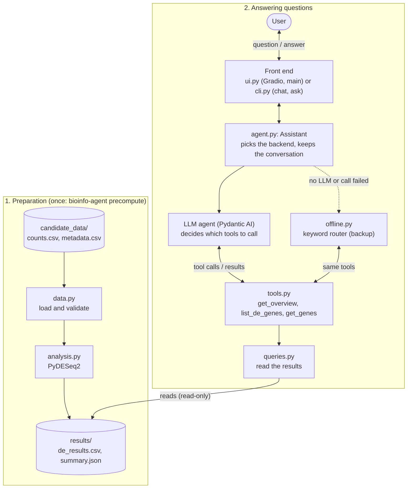

# bioinfo-agent

A small agent that answers questions about a bulk RNA-seq differential expression (DE) analysis
(control vs treated). The analysis is precomputed, so every number the agent reports comes from the results.

## Install

Requires [uv](https://docs.astral.sh/uv/), which also installs Python 3.12 if needed.

**macOS / Linux**

```bash
curl -LsSf https://astral.sh/uv/install.sh | sh
uv sync
```

**Windows (PowerShell)**

```powershell
powershell -ExecutionPolicy ByPass -c "irm https://astral.sh/uv/install.ps1 | iex"
uv sync
```

## Run

```bash
uv run bioinfo-agent ui       # chat in the browser at http://127.0.0.1:7860
```

This is the main way to use the app. It works with no setup (offline mode); see "Agent" below to connect an LLM.
Options: `--backend auto|openai|compatible|offline`, `--port`, `--host`.

### Command line (additional tools)

```bash
uv run bioinfo-agent chat     # the same chat in the terminal
uv run bioinfo-agent ask "Is STAT1 differentially expressed?"   # one question
uv run bioinfo-agent info     # cohort summary: genes, samples, samples per condition
uv run bioinfo-agent genes    # analysis overview and top DE genes (--direction up|down, -n 20, --sort-by log2fc)
uv run bioinfo-agent gene STAT1 CIITA   # look up genes (case-insensitive, suggests close names)
uv run bioinfo-agent precompute         # re-run the DE analysis (about 20 s), rewrites results/
uv run pytest                 # tests
```

## Architecture

Two separate flows: the analysis is prepared once, then questions are answered by an agent that can only read
the prepared results through tools.



- Only `precompute` reads the raw counts. At question time everything reads `results/`, and the LLM never sees raw counts.
- The LLM decides which tool to call and writes the answer from the tool results. Every number must come from a tool.
- If no LLM is configured, or an LLM call fails, `Assistant` answers through the offline router, which calls the same tools.
- The UI and the CLI share one `Assistant`, so both give the same answers. The CLI commands `genes`, `gene` and `info` skip the agent and call `queries.py` or `data.py` directly.

## Project structure

```text
.
├── candidate_data/          Input: counts.csv (genes x samples), metadata.csv
├── results/                 Precomputed DE results (committed): de_results.csv, summary.json
├── src/bioinfo_agent/
│   ├── data.py              Load counts and metadata, check sample IDs, derive lane
│   ├── analysis.py          PyDESeq2 run (`precompute`), writes results/
│   ├── queries.py           Read results/: overview, top genes, gene lookup
│   ├── tools.py             The three tools the agent can call (wrap queries.py)
│   ├── offline.py           Keyword router that answers without an LLM
│   ├── agent.py             Backend selection, Pydantic AI agent, Assistant (conversation + fallback)
│   ├── ui.py                Gradio chat front end
│   └── cli.py               Typer commands: ui, chat, ask, genes, gene, info, precompute
├── tests/                   pytest (data, analysis, queries, agent, CLI, UI)
├── .github/workflows/       CI: lint, tests, CLI smoke checks on macOS and Windows
├── .env.example             Backend settings (OPENAI_API_KEY, LLM_BASE_URL, ...)
└── pyproject.toml           Dependencies and the `bioinfo-agent` entry point
```

## Agent

**Quick start.** With no setup the app runs in offline mode (keyword matching, no LLM, no network), which answers the three core questions. For free-form questions, copy `.env.example` to `.env` and set your own `OPENAI_API_KEY` (or point `LLM_BASE_URL` at a local server). Then run `uv run bioinfo-agent chat`.

`chat` and `ask` print each tool call and a one-line result, then the model's reasoning summary when the backend provides one, then the answer. The model never sees the raw counts: it calls three tools (`get_overview`, `list_de_genes`, `get_genes`) over the precomputed results, and its prompt requires every number to come from a tool result.

`ui` serves the same agent as a Gradio chat. Each tool call, tool result and reasoning summary appears as a collapsible message above the answer, example prompts fill the input box, and the active backend is shown at the top. Each browser session has its own conversation; "New conversation" resets it.

### Backends

| Backend | Settings | Notes |
| --- | --- | --- |
| OpenAI (best tool use) | `OPENAI_API_KEY`, optional `OPENAI_MODEL` | Only your question and tool results are sent, not the counts. |
| Compatible (local or hosted) | `LLM_BASE_URL`, `LLM_MODEL` | Any OpenAI-compatible server. Ollama: `http://localhost:11434/v1`. llamafile: `http://localhost:8080/v1`. Small local models may skip tools or misformat calls. |
| Offline (default) | nothing | Keyword matching for the three core questions, using the same queries. |

`--backend auto|openai|compatible|offline` forces a choice. With `auto`, `LLM_BASE_URL` wins over
`OPENAI_API_KEY`, which wins over offline. If an LLM call fails (bad key, server down), the question is
answered in offline mode with a notice. There is one OpenAI-compatible client, so switching to a local
server is just a different `LLM_BASE_URL`. I did not make local inference the default: on a 16 GB CPU-only
laptop small models call tools unreliably, and a llamafile with weights above 4 GB cannot run on Windows.

## Development

CI ([.github/workflows/ci.yml](.github/workflows/ci.yml)) runs lint, tests and the `info`, `gene` and offline `ask` commands on macOS and Windows.

The data directory defaults to `candidate_data/`; set `BIOINFO_DATA_DIR` to use another one.
Results are read from `results/`; set `BIOINFO_RESULTS_DIR` to use another directory.

## Data notes

- `counts.csv`: 15,831 genes (rows) x 90 samples (columns), raw integer counts.
- `metadata.csv`: `sample_id`, `condition` (control / treated).
- Groups: 40 control, 50 treated.
- The sample ID suffix is the sequencing lane. Every `_L2` sample is treated, so the groups are
  control-L1 (40), treated-L1 (25) and treated-L2 (25): lane is partly confounded with condition.

## Analysis

The analysis is precomputed with [PyDESeq2](https://pydeseq2.readthedocs.io/) and committed in
`results/de_results.csv` (one row per gene) and `results/summary.json` (design, thresholds, counts, size
factors). Questions are answered from these files only.

- **Filter:** genes with fewer than 10 reads in total are dropped (none were: all 15,831 genes are tested).
- **Model:** `~ condition`, treated vs control. A positive log2FC means higher in treated.
- **Fold changes:** shrunken (`lfc_shrink`), which stabilises low-count genes. The unshrunken value is
  kept as `log2fc_unshrunk`.
- **Significant:** adjusted p-value (Benjamini-Hochberg) `padj < 0.05` and `|log2FC| >= 1`.
  Result: 222 up, 100 down.
- Where `padj` underflows to 0, genes are ranked by `|stat|`.

### Example genes

| Gene | Verdict |
| --- | --- |
| CIITA | Up in treated: log2FC +1.34, padj 1.6e-76 |
| SPATS2L | Up in treated: log2FC +1.14, padj 2.2e-14 |
| IDH3B | Not DE: log2FC -0.06, padj 1 |
| STAT1 | Not DE: log2FC -0.03, padj 1 |

### Observations and future directions

- **Lane:** the sample ID suffix is the sequencing lane, and every `_L2` sample is treated (control-L1 40,
  treated-L1 25, treated-L2 25), so lane is partly confounded with condition. It is not in the model.
  Next step: compare against `~ lane + condition` (treatment effect estimated from L1 only) and flag genes
  whose call changes. A quick check suggests SPATS2L and IDH3B are among them.
- Sex-marker genes are not in the data, so sex balance across groups cannot be checked.
