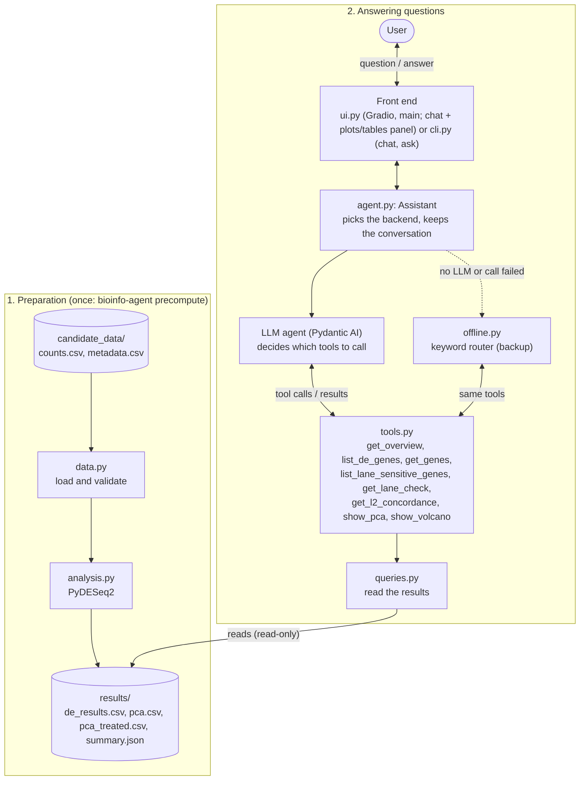

# bioinfo-agent

A small agent that answers questions about a bulk RNA-seq differential expression (DE) analysis
(control vs treated). The analysis is precomputed, so every number the agent reports comes from the results.

## Install

Requires [uv](https://docs.astral.sh/uv/), which also installs Python 3.12 if needed.

**macOS / Linux**

```bash
curl -LsSf https://astral.sh/uv/install.sh | sh
uv sync
```

**Windows (PowerShell)**

```powershell
powershell -ExecutionPolicy ByPass -c "irm https://astral.sh/uv/install.ps1 | iex"
uv sync
```

## Run

```bash
uv run bioinfo-agent ui       # chat in the browser at http://127.0.0.1:7860
```

This is the main way to use the app. It works with no setup (offline mode); see "Agent" below to connect an LLM.
Options: `--backend auto|openai|compatible|offline`, `--port`, `--host`.

### Command line (additional tools)

```bash
uv run bioinfo-agent chat     # the same chat in the terminal
uv run bioinfo-agent ask "Is STAT1 differentially expressed?"   # one question
uv run bioinfo-agent info     # cohort summary: genes, samples, samples per condition
uv run bioinfo-agent genes    # analysis overview and top DE genes (--direction up|down, -n 20, --sort-by log2fc)
uv run bioinfo-agent gene STAT1 CIITA   # look up genes (case-insensitive, suggests close names)
uv run bioinfo-agent lane               # lane confounding check: summary and genes whose call changes with lane
uv run bioinfo-agent precompute         # re-run the analysis and PCA (about a minute), rewrites results/
uv run pytest                 # tests
```

## Architecture

Two separate flows: the analysis is prepared once, then questions are answered by an agent that can only read
the prepared results through tools.



- Only `precompute` reads the raw counts. At question time everything reads `results/`, and the LLM never sees raw counts.
- The LLM decides which tool to call and writes the answer from the tool results. Every number must come from a tool.
- If no LLM is configured, or an LLM call fails, `Assistant` answers through the offline router, which calls the same tools.
- The UI and the CLI share one `Assistant`, so both give the same answers. The CLI commands `genes`, `gene`, `lane` and `info` skip the agent and call `queries.py` or `data.py` directly.

## Project structure

```text
.
├── candidate_data/          Input: counts.csv (genes x samples), metadata.csv
├── results/                 Precomputed (committed): de_results.csv, pca.csv, pca_treated.csv, summary.json
├── src/bioinfo_agent/
│   ├── config.py            Thresholds, file names, data/results paths (light imports only)
│   ├── data.py              Load counts and metadata, check sample IDs, derive lane
│   ├── analysis.py          PyDESeq2 runs (three models) and PCA (`precompute`), writes results/
│   ├── queries.py           Read results/: overview, top genes, gene lookup, lane check
│   ├── tools.py             The eight tools the agent can call (wrap queries.py), plus result summaries
│   ├── plots.py             Volcano and PCA figures (plotly), built from results/
│   ├── reply.py             Reply and Step: what an answer looks like to the CLI and UI
│   ├── offline.py           Keyword router that answers without an LLM
│   ├── agent.py             Backend selection, Pydantic AI agent, Assistant (conversation + fallback)
│   ├── ui.py                Gradio front end: chat, plus a side panel for plots, tables and history
│   └── cli.py               Typer commands: ui, chat, ask, genes, gene, lane, info, precompute
├── tests/                   pytest (data, analysis on a small synthetic dataset, queries, agent, CLI, UI)
├── .github/workflows/       CI: lint, format check, tests, CLI smoke checks on Linux, macOS and Windows
├── .env.example             Backend settings (OPENAI_API_KEY, LLM_BASE_URL, ...)
└── pyproject.toml           Dependencies and the `bioinfo-agent` entry point
```

## Agent

**Quick start.** With no setup the app runs in offline mode (keyword matching, no LLM, no network), which answers gene, DE-list, volcano, PCA and lane questions. For free-form questions, copy `.env.example` to `.env` and set your own `OPENAI_API_KEY` (or point `LLM_BASE_URL` at a local server). Then run `uv run bioinfo-agent chat`.

`chat` and `ask` print each tool call and a one-line result, then the model's reasoning summary when the backend provides one, then the answer. The model never sees the raw counts: it calls eight tools over the precomputed results (`get_overview`, `list_de_genes`, `get_genes`, and for the lane question `list_lane_sensitive_genes`, `get_lane_check`, `get_l2_concordance`, `show_pca`, `show_volcano`), and its prompt requires every number to come from a tool result.

`ui` serves the same agent as a Gradio chat. Each tool call, tool result and reasoning summary appears as a collapsible message above the answer, example prompts below the input box fill it, and the active backend is shown at the top. Plots and gene tables do not clutter the chat: they open in a collapsible panel on the right (fold it away for a wider chat) with three tabs. **Plots** shows the volcano plot (every gene, up/down/not significant, optionally marking genes; hover, zoom and legend toggles are interactive) and the PCA plots; **Tables** shows gene lists, where clicking a row marks that gene on the volcano plot and shows its verdict; **History** lists every plot and table of the conversation, and clicking a row reopens it. Ask "Show the volcano plot" (or "lane-adjusted volcano plot", "volcano plot marking STAT1"). Each browser session has its own conversation; "New conversation" resets it.

### Backends

| Backend | Settings | Notes |
| --- | --- | --- |
| OpenAI (best tool use) | `OPENAI_API_KEY`, optional `OPENAI_MODEL` | Only your question and tool results are sent, not the counts. |
| Compatible (local or hosted) | `LLM_BASE_URL`, `LLM_MODEL` | Any OpenAI-compatible server. Ollama: `http://localhost:11434/v1`. llamafile: `http://localhost:8080/v1`. Small local models may skip tools or misformat calls. |
| Offline (default) | nothing | Keyword matching for gene, DE-list, volcano, PCA and lane questions, using the same queries. |

`--backend auto|openai|compatible|offline` forces a choice. With `auto`, `LLM_BASE_URL` wins over
`OPENAI_API_KEY`, which wins over offline. If an LLM call fails (bad key, server down), the question is
answered in offline mode with a notice. There is one OpenAI-compatible client, so switching to a local
server is just a different `LLM_BASE_URL`. I did not make local inference the default: on a 16 GB CPU-only
laptop small models call tools unreliably, and a llamafile with weights above 4 GB cannot run on Windows.

## Development

CI ([.github/workflows/ci.yml](.github/workflows/ci.yml)) runs lint, the format check, tests and the `info`, `gene`, `lane` and offline `ask` commands on Linux, macOS and Windows.

The data directory defaults to `candidate_data/`; set `BIOINFO_DATA_DIR` to use another one.
Results are read from `results/`; set `BIOINFO_RESULTS_DIR` to use another directory.
Both can be set in `.env`, which every command loads. The default paths are relative to the source checkout, so run the app from a clone (`uv sync`), not from a built wheel.

The UI has no login. It listens on `127.0.0.1` by default; do not use `--host 0.0.0.0` with an `OPENAI_API_KEY` set unless the network is trusted, since anyone who can reach the page spends your quota.

The tests run the whole pipeline (PyDESeq2, PCA, saving, querying) on a small synthetic dataset with planted up, down and lane-only effects (`tests/conftest.py`), so they take seconds. They also check the committed `results/` against the numbers quoted below.

## Data notes

- `counts.csv`: 15,831 genes (rows) x 90 samples (columns), raw integer counts.
- `metadata.csv`: `sample_id`, `condition` (control / treated).
- Groups: 40 control, 50 treated.
- The sample ID suffix is the sequencing lane. Every `_L2` sample is treated, so the groups are
  control-L1 (40), treated-L1 (25) and treated-L2 (25): lane is partly confounded with condition.

## Analysis

The analysis is precomputed with [PyDESeq2](https://pydeseq2.readthedocs.io/) and committed in
`results/de_results.csv` (one row per gene), `results/pca.csv` and `results/pca_treated.csv` (sample scores, all and treated only) and `results/summary.json`
(design, thresholds, counts, lane check, versions). Questions are answered from these files only.

- **Filter:** genes with fewer than 10 reads in total are dropped (none were: all 15,831 genes are tested).
- **Headline model:** `~ condition`, treated vs control. A positive log2FC means higher in treated.
- **Fold changes:** shrunken (`lfc_shrink`), which stabilises low-count genes. The unshrunken value is
  kept as `log2fc_unshrunk`. Shrinkage is not perfect for very low counts: 22 genes (median mean count 21,
  only 2 of them DE) have a shrunken fold change more than 0.3 larger than the unshrunken one.
- **Significant:** adjusted p-value (Benjamini-Hochberg) `padj < 0.05` and `|log2FC| >= 1`.
  Result: 222 up, 100 down.
- Where `padj` underflows to 0, genes are ranked by `|stat|`.

### Lane: a confounder checked four ways

The sample ID suffix is the sequencing lane. Every `_L2` sample is treated (no control sample is in L2), so
lane cannot be separated from treatment for those 25 samples. The headline stays `~ condition`, and
four checks show how much lane matters (`bioinfo-agent lane`, or ask the chat):

1. **Lane-adjusted model, `~ lane + condition`.** The treatment effect now comes from treated-L1 vs
   control-L1 only (25 vs 40 samples), so it has less power. Each gene gets a `lane_flag`:
   `same`, `lost` (DE without lane, not DE with it), `gained` (the opposite) or `flipped` (reverses
   direction). Result: 277 DE genes (174 up, 103 down); 15,742 genes `same`, 67 `lost`, 22 `gained`, none `flipped`.
2. **Treated-L2 vs treated-L1.** Every sample is treated here, so a difference is a lane effect, not treatment.
   501 genes differ at padj < 0.05 (371 also with |log2FC| >= 1). 53 of the 67 `lost` genes and 12 of the 22
   `gained` genes are among them, which supports reading those flags as lane effects.
3. **PCA** (VST counts, 2,000 most variable genes, blind to the design). PC1 (17% of the variance) orders
   control-L1 (-14.9) < treated-L1 (+6.8) < treated-L2 (+17.1). Treated-L1 vs control-L1 on PC1: Mann-Whitney
   p = 2e-11; treated-L2 vs treated-L1: p = 1e-09. Lane therefore moves samples along the same axis as the
   treatment, by about half as much. A second PCA on the 50 treated samples only removes the treatment axis:
   L1 and L2 still separate, on PC2 (12% of the variance, p = 3e-09), PC1 (p = 0.003) and PC3 (p = 0.02), so
   that separation is a lane effect. Both plots are available in the UI ("Show the PCA").
4. **Directional check in L2.** The 277 lane-adjusted DE genes are estimated from L1 samples only. In
   treated-L2 vs control-L1 (65 samples), 270 of them (97.5%) move the same way (up 98.3%, down 96.1%), and
   260 of the 262 that are also significant in L2 agree (99.2%). The baseline
   matters: genes that are not DE agree 62.3% of the time, because the lane shift alone biases the sign, so
   the excess over that is the evidence. The two comparisons share the control-L1 samples, so this supports
   the genes but is not an independent replicate. Ask the chat "Are the lane-adjusted genes confirmed in L2?".

How to read it: a `lost` gene is a gene to be cautious about, not proof of an artefact. The adjusted model has
less power, and 27 of the 67 `lost` genes are still significant after adjustment (they miss only the
`|log2FC| >= 1` rule). Lane-flagged genes are ranked by the change in log2FC, so the clear cases come first.
Verdicts for flagged genes show the lane-adjusted numbers and a caution. With only one lane per control sample
the data cannot settle this; the collaborator should say whether L2 was a separate run or batch.

### Reading the lane columns in `de_results.csv`

Two adjusted p-values answer different questions on different samples, so read them together:

| Column | Model and samples | Question |
| --- | --- | --- |
| `log2fc_lane_adj`, `padj_lane_adj` | `~ lane + condition`, all 90 samples (effect comes from treated-L1 vs control-L1) | Does treatment change this gene once lane is accounted for? |
| `log2fc_lane_effect`, `padj_lane_effect` | `~ lane`, the 50 treated samples (L2 vs L1) | Does lane change this gene when every sample is treated? |

- Significant treatment, no lane effect (CIITA): a solid call.
- Not significant after adjustment, strong lane effect (SPATS2L): the headline call was probably a lane effect.
- Significant after adjustment, strong lane effect (IDH3B): lane was masking a treatment effect.
- Both use treated-L1, so they are not independent evidence. The lane-effect test cannot say whether the L1/L2
  difference is technical or biological; it only shows the two treated groups differ.
- Many `padj` values are about 1 (for example 0.9999). That means no evidence of an effect: Benjamini-Hochberg
  adjustment makes adjusted p-values non-decreasing, so a large block of weak genes all end at the largest raw
  p-value (0.999934 for 14,814 genes in the lane-adjusted model).

### Example genes

| Gene | Headline (`~ condition`) | Lane-adjusted | Reading |
| --- | --- | --- | --- |
| CIITA | Up: log2FC +1.34, padj 1.6e-76 | Up: +1.31, padj 4.4e-51 | Holds after adjusting for lane. |
| SPATS2L | Up: log2FC +1.14, padj 2.2e-14 | Not DE: +0.05, padj 1 | `lost`: L2 vs L1 log2FC +1.72 (padj 1e-73), likely a lane effect. |
| IDH3B | Not DE: log2FC -0.06, padj 1 | Down: -1.06, padj 1e-138 | `gained`: treated-L2 is higher than treated-L1 (+1.56), which hides a decrease seen in L1. |
| STAT1 | Not DE: log2FC -0.03, padj 1 | Not DE: -0.05, padj 1 | Not DE either way. |

### Observations

- Sex-marker genes are not in the data, so sex balance across groups cannot be checked.

## Deep directions

I chose two directions. Both make sure the scientific findings are correct and well explained to biologists, and that the agent output can be used and investigated by the end user.

1. **Lane adjustment analysis.** Lane is partly confounded with treatment (every L2 sample is treated), so the headline result alone could mislead. Four checks (lane-adjusted model, treated L2 vs L1, PCA, directional check in L2) flag each gene as `same`, `lost`, `gained` or `flipped`, and the agent adds a caution to flagged genes.
2. **Frontend UI.** A chat with a navigable panel: interactive volcano plot, PCA plots, clickable gene tables and a history of every plot and table, so the user can investigate the results behind each answer.

## Future development

- Conversation and analysis database: remember interactions per user and pull up past analyses quickly. Results are stored as CSV now; a database scales better.
- Collect feedback from end users and stakeholders to find missing features.
- LLM as a judge on a golden dataset: completeness, correctness and whether the tool-call path makes sense for different inputs.
- Version control and traceability (MLflow, LangSmith, ...): prompts, eval dataset, inputs, and each call.

## Use of coding assistants

Most of the code was generated by an assistant. The code verification, architecture, UI and tools were designed by me, which let me iterate quickly to an MVP.

Version control is organised by building blocks, each tested and working before the next:

1. Project setup
2. Test/CI workflow
3. Deterministic analysis with PyDESeq2
4. Agentic harness (model, tools, etc.) with basic features
5. Chatbot UI
6. Extra features

- **Checked:** mostly the workflow, e.g. that the differential analysis uses the right input and follows the PyDESeq2 example.
- **Corrected:** mostly the architecture, e.g. I moved the agent tools into their own file (`tools.py`) so they are reusable and easier to navigate.
- **Rejected:** some UI changes that were too time-consuming for a prototype.
- **Pros:** efficiency and debugging, which allow quick prototyping.
- **Cons:** every change must be clearly specified; under-specification can lead to unwanted changes. The human has to act as reviewer and architect.
